<p align="center"></p>

<h1 align="center">Keystone</h1>
<p align="center">A real estate app template for Flutter. Find a home to rent or buy, save the ones you like, book a viewing, and keep the paperwork in one place.</p>

<p align="center">
  <a href="https://flutterzip.com"></a>
  <a href="https://instagram.com/flutter_zip"></a>
  
  
  
  
  
</p>

<p align="center">
  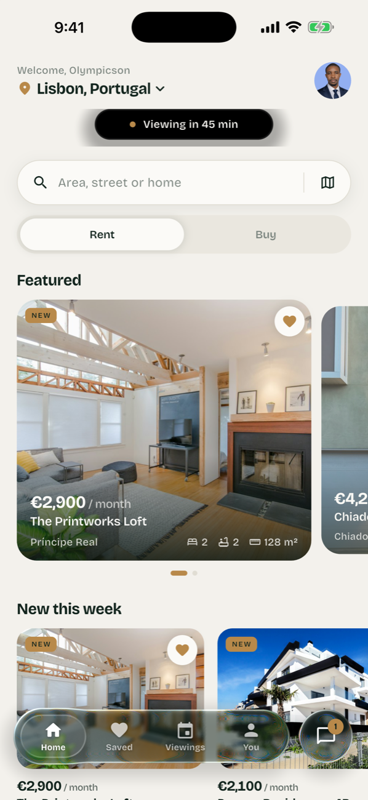
  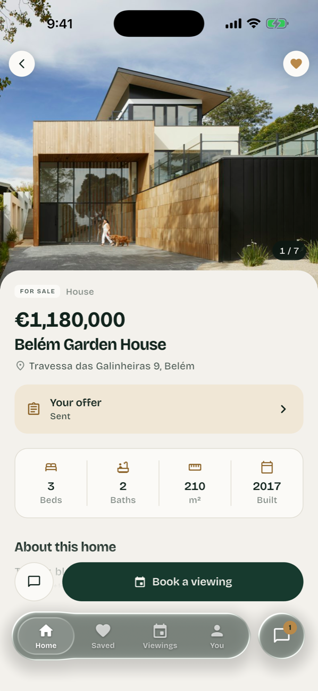
  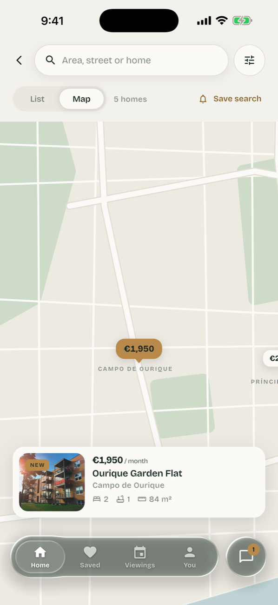
  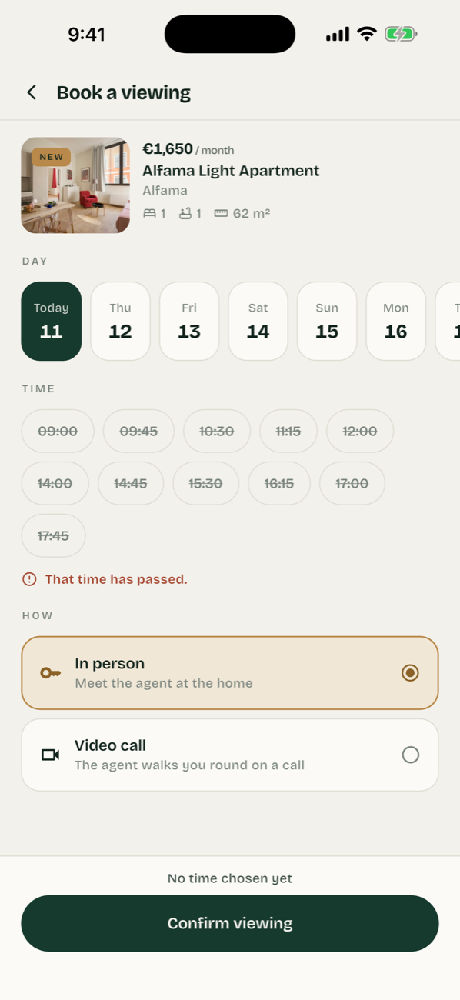
  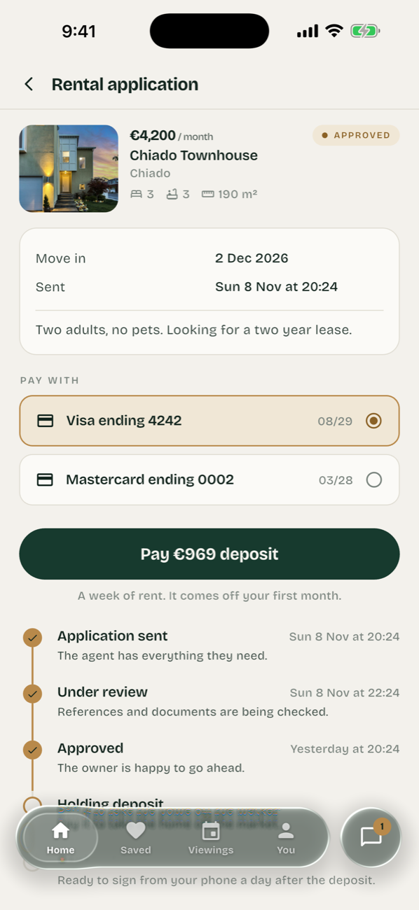
  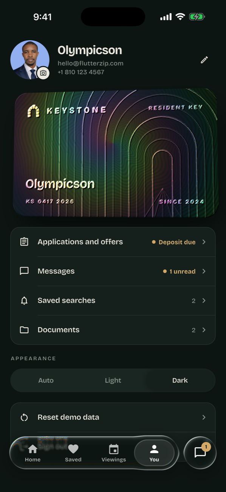
</p>

## Highlights

- **Splash to sign out.** Splash, onboarding, sign in and sign up (with Apple and Google), Home, Search, Property, Gallery, Brochure, Book a viewing, Saved and Compare, Viewings, Messages, Applications and offers, Profile. Light and dark.
- **A logo that means something.** An arch of cut stones locked by one brass keystone. On the splash it builds itself stone by stone, the keystone drops in, and the camera walks through the doorway into the app. The same arch confirms a booked viewing.
- **Every colour in one file.** `lib/config/palette.dart` holds the light and dark palettes: limestone paper, evergreen ink and one brass accent. A test fails if a colour is written anywhere else. The app icon is drawn from the same file.
- **Motion that explains.** A saved home flies into the Saved tab. Booking arrives through ink from the button you pressed. A cancelled viewing blows away as dust and re-forms on Undo. A viewing within the hour is a live countdown pill. The holding deposit button becomes its own receipt. The key card is holographic foil that follows the phone's tilt. The brochure turns like paper.
- **Drawn, not embedded.** The city map (streets, parks, the river, pins) and every floor plan are painted in code from the seed data. No map SDK and no API keys.
- **Nothing is tallied twice.** A viewing stores when it is, an application stores when it was sent: whether they are upcoming, soon, approved or due is worked out from the clock, so every screen agrees. The mortgage and rent calculators work live from the price.
- **Full create, edit and delete** on viewings, messages, applications, documents, saved homes and saved searches, each with loading, empty and error states you can reach from the demo data.
- **One switch to a real backend.** Six repositories, all chosen in `lib/providers/core_providers.dart`. The seed files are already in the JSON shape an API would send.

## Screens

| | | | | |
|---|---|---|---|---|
| 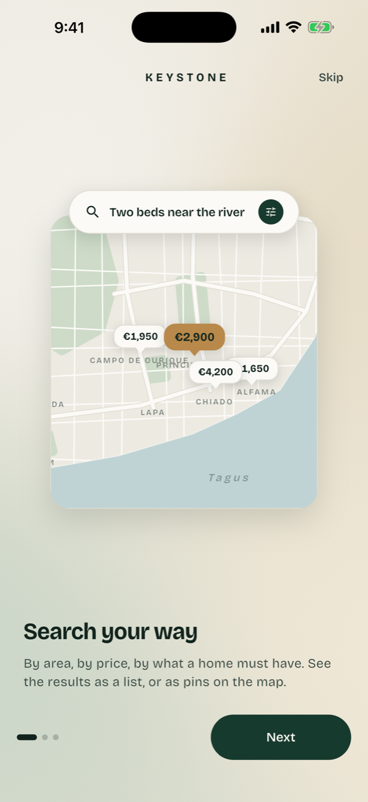 | 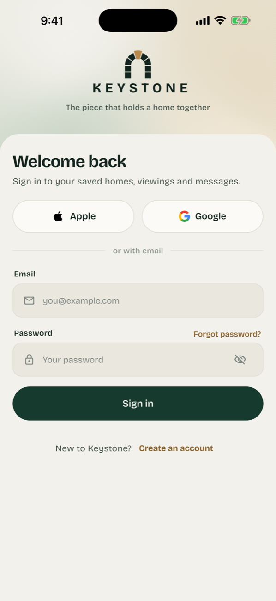 |  |  |  |
|  | 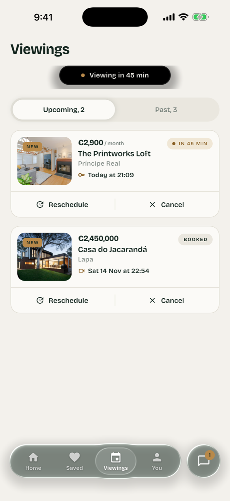 | 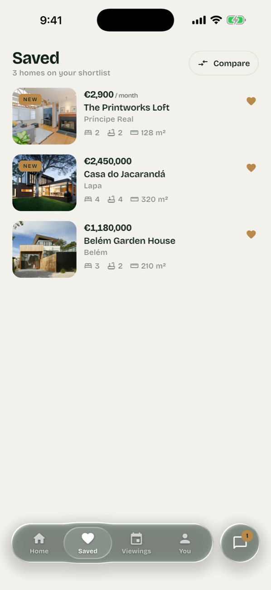 | 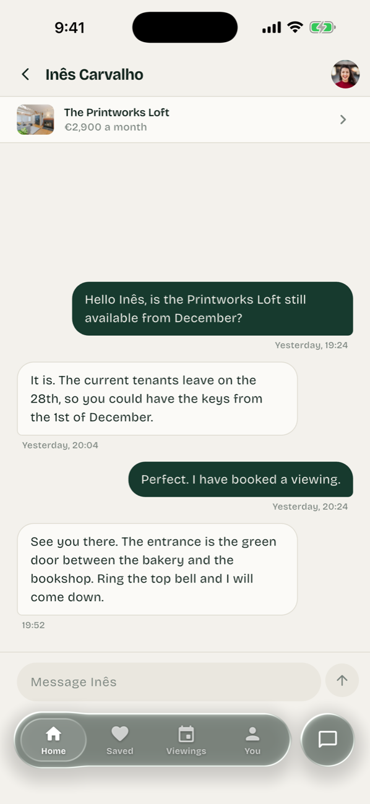 |  |
| 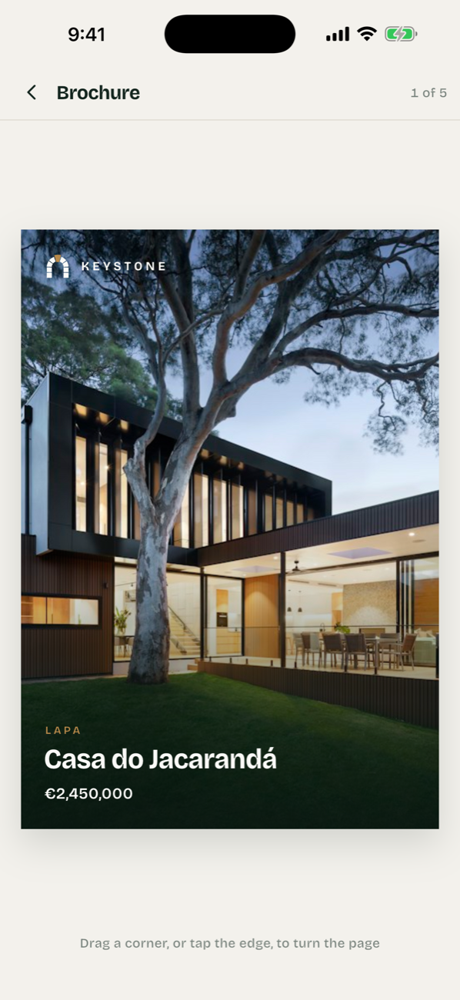 | 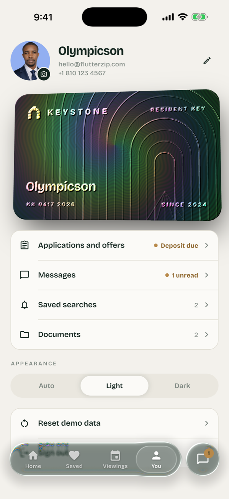 | 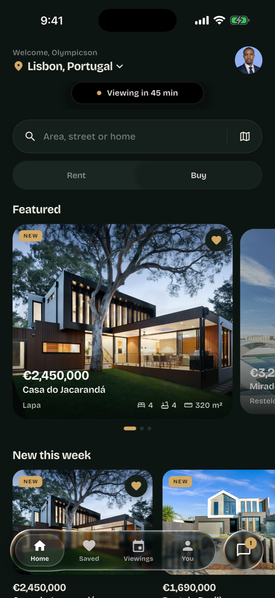 | 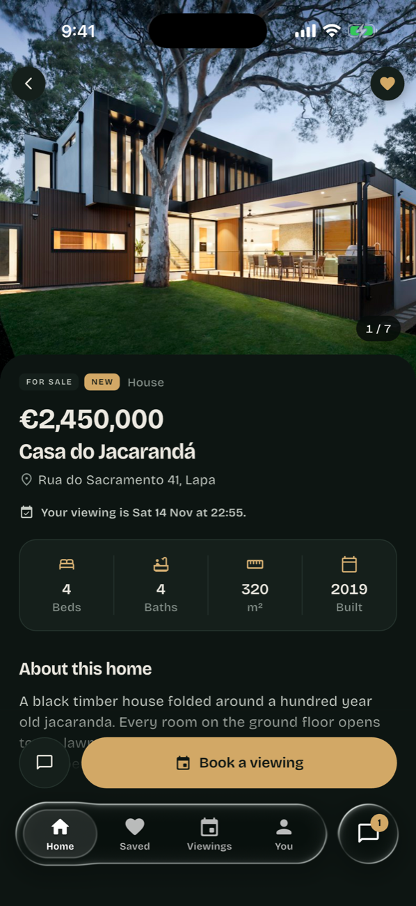 |  |

## Try the demo

- **Sign in with anything.** Any well-formed email and password signs you in as the demo person. The password `wrongpass` shows the wrong-password state.
- **A viewing is about to start.** On a fresh install (or after Profile, Reset demo data) one viewing is 45 minutes away, so the countdown pill is on Home and Viewings.
- **Taken times explain themselves.** In Book a viewing, tap a struck-through time to see why. Sundays have no viewings.
- **Pay a deposit.** Profile, Applications and offers, Chiado Townhouse is approved with a deposit due. The card ending `0002` is declined; the Visa pays.
- **Make an offer.** Belém Garden House has been viewed: open it and use "Your offer", or withdraw it and send another.
- **Compare.** Saved, Compare, choose two homes.
- **Search.** Try "garden", the filters, the map, and a search for "castle" for the empty state. Save a search and find it in Profile.

## Getting started

```bash
flutter pub get
flutter run
```

Flutter 3.38 or newer. The shader effects need Impeller, which is the default on iOS and Android.

## Make it yours

| To change | Edit |
|---|---|
| Every colour, light and dark | `lib/config/palette.dart` |
| The app icon, from the palette | `python3 tool/make_mark.py && python3 tool/make_icons.py` |
| The name, tagline and city | `lib/config/app_brand.dart` |
| The logo's shape | `MarkGeometry` in `lib/widgets/keystone_mark.dart` (and the same numbers in `tool/make_mark.py`) |
| Homes, agents, the map, viewings, messages | `assets/data/*.json`, or the tables in `tool/make_seed.py` |
| Photographs | `assets/images/homes/`, referenced from `homes.json` |
| Typeface and type scale | `lib/config/app_theme.dart` |
| How things move, and how long the app waits | `lib/config/motion.dart`, `lib/config/app_timing.dart` |
| Spacing and radii | `lib/config/design_tokens.dart` |
| The launch screen colour | `ios/Runner/Assets.xcassets/LaunchBackground.colorset`, `android/app/src/main/res/values*/colors.xml` |

## Connect a backend

Every screen reads through a repository, and each one is chosen in `lib/providers/core_providers.dart`. Write the `Remote...` class sketched at the foot of each file and return it there. No widget, provider or model changes.

| Repository | Serves |
|---|---|
| `ListingRepository` | Homes, agents, the map |
| `AuthRepository` | Sign in, sign up, Apple and Google, password reset |
| `AccountRepository` | Profile, cards, saved homes, recently viewed, saved searches, documents |
| `ViewingRepository` | Viewings and the times on offer |
| `MessageRepository` | Threads and messages |
| `ApplicationRepository` | Applications, offers and the holding deposit |

Profile photos go through `MediaStore` (`lib/services/media_store.dart`), the place to swap in an uploader.

## Project structure

```
lib/
  config/      palette, theme, brand, motion, timing, tokens, launch hooks
  models/      Home, Viewing, MessageThread, Application, Money, CityMap
  services/    the repositories, the seed, the store, media
  providers/   Riverpod state; core_providers.dart is the data switchboard
  widgets/     the mark, cards, the map, the floor plan, sheets, buttons
  screens/     one folder per screen
  kit/         shader and physics components (glass bar, ink route, foil)
assets/data/   the demo data, one JSON file per entity
tool/          seed, icon and screenshot scripts
```

## How it is built

Riverpod for state, `shared_preferences` for what the person changes on top of the seed, and one navigator per tab so pages open inside their tab and the glass bar stays. The seed stores relative times ("45 minutes from first launch"), which are turned into dates once, so the demo never goes stale. Animations drive painters and listenables rather than rebuilding widgets, loops stop when they are off screen, photographs are decoded at the size they are shown, and everything honours reduce motion.

## Testing

```bash
flutter analyze
flutter test
```

134 tests: models and money, the seed (every state reachable), repositories, each screen, the whole app from splash to a booked viewing, and guards on the source (colours only in the palette, no file over 500 lines).

`tool/run.sh` runs on the simulator with hot reload on a pipe, and `tool/shots.sh` retakes the screenshots above.

## Made by FlutterZip

One Flutter app a day at [flutterzip.com](https://flutterzip.com) and [@flutter_zip](https://instagram.com/flutter_zip).

## Credits

- Property and agent photographs from [Unsplash](https://unsplash.com), under the [Unsplash License](https://unsplash.com/license). The source of each file is listed in `tool/photo_sources.json`.
- [Bricolage Grotesque](https://github.com/ateliertriay/bricolage) by Mathieu Triay, SIL Open Font License (`assets/fonts/OFL.txt`).
- Material Symbols icons, Apache 2.0.

## License

The code is released under the [MIT License](LICENSE): use it in personal and commercial apps, free.
The photographs are under the [Unsplash License](https://unsplash.com/license) and the Bricolage Grotesque font under the [SIL Open Font License 1.1](assets/fonts/OFL.txt).
